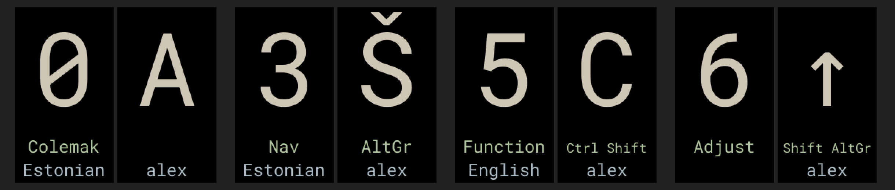
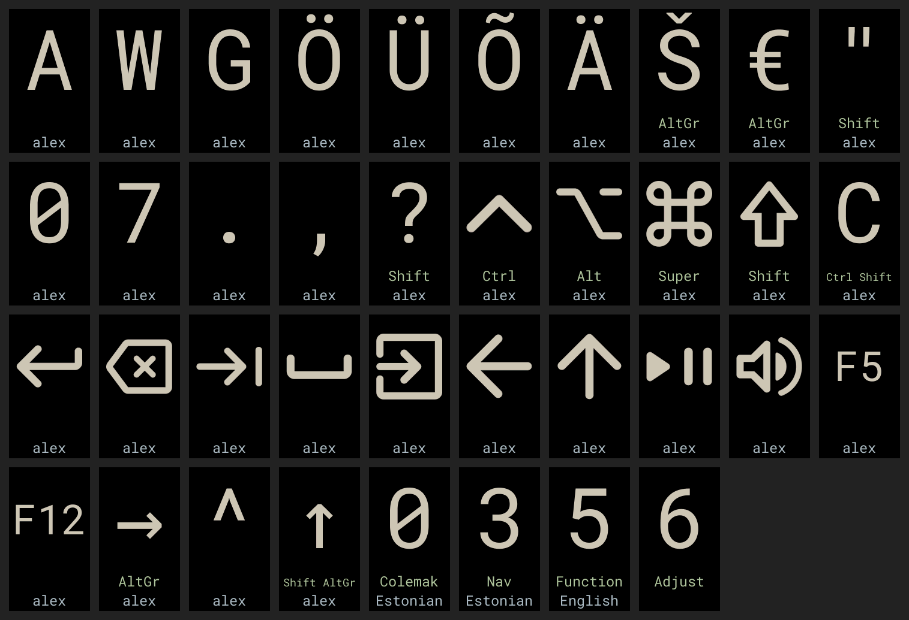

# Kyria v4 setup

Firmware, tools and backups for a **splitkb.com Halcyon Kyria rev4** with the
Halcyon TFT display on both halves (Vial, QMK).



- **Right screen:** the last key you pressed, large. Letters are always
  capitals; Shift, Ctrl, Alt, Super, Enter, arrows, media keys and so on show
  as symbols. Below it: the modifiers you are holding (`Ctrl Shift`, `AltGr`,
  `Meh`, `Hyper`) and your user name.
- **Left screen:** the current layer number, its name, and the computer's
  keyboard language.
- **Keyboard language aware:** with the computer set to Estonian, the right
  screen shows what is actually typed (Ö, Ä, Ü, Õ, Š, Ž, €, …). US English and
  Estonian (with and without dead keys) are built in.
- Lumi Earth colours on black: sand for the large character, leaf green and
  mist blue for the two text rows. Anti-aliased Roboto Mono and Material
  Symbols, drawn at 16 grey levels.

The firmware cannot know your user name, keyboard language or layer names by
itself; a small helper program on the computer sends them over USB (see
[The computer helper](#the-computer-helper)). Without it the keyboard still
works fully; those rows just stay empty and the screen shows US characters.



The images above are rendered from the real firmware drawing code and font
data by `make preview`, not mock-ups.

## What is where

| Path | What |
| --- | --- |
| `release/kyria_rev4_keypress_display.uf2` | The firmware currently on the keyboard (both halves) |
| `backups/` | The keyboard's keymap, macros and Vial settings, plus Vial exports and splitkb's stock firmware ([details](backups/README.md)) |
| `host/` | The computer helper, its login service, the device permission rule and `layer-names.txt` |
| `firmware/` | QMK userspace: the `keypress_hlc` keymap and splitkb's Halcyon modules ([details](firmware/README.md)) |
| `tools/` | Asset generators, preview renderer, backup / restore / flash scripts |
| `fonts/` | The fonts the screen images are made from, with their licences |
| `tests/` | Host tests that run the real display code against stubbed QMK |
| `setup.sh` | Fetches pinned tools and sources into `.venv/` and `.deps/` |

## After reinstalling the computer

The keyboard keeps its firmware and layout; only the computer side needs
setting up again.

1. Install the basics (openSUSE shown; other distributions have the same
   packages): `sudo zypper install git python3 gcc make zstd libhidapi-hidraw0 libxkbcommon0`
2. Get this project and fetch its pinned tools (about 2 GB, a few minutes):
   ```sh
   git clone https://github.com/fwhskr/kyria-v4-setup.git
   cd kyria-v4-setup
   ./setup.sh
   ```
3. Allow your user to talk to the keyboard (asks for your password once):
   `make udev`, and check you are in the `input` group (`groups`).
4. Start the screen helper now and at every login: `make install-helper`

That's all: the screens show your user name, language and layer names again.
Vial (the layout editor app) also needs step 3.

## Changing layer names

Edit `host/layer-names.txt`: one name per line, layer 0 first. The helper
notices the change and updates the screen within seconds; no firmware update
is needed. Up to 9 letters show full size, up to 12 in smaller text.

## Changing the layout

For **Estonian character-first editing and readable typing-reference images**, use
[Keymap Studio](keymap-studio/README.md). Download this repository, then open
`keymap-studio/index.html` in your browser — no installation, server or keyboard
connection is needed. Export a `.vil` file and load it using Vial when you are
ready to apply your changes. The studio does not flash or write to your keyboard.

Use [Vial](https://get.vial.today/) as usual. To keep a copy here, save it in
Vial (*File → Save current layout*) into `backups/`, or run `make backup` to
read the keymap and settings straight from the keyboard. Commit the result.

## Updating the firmware

```sh
make test        # display code and key mapping tests
make firmware    # builds .build/kyria_rev4_keypress_display.uf2
make flash       # then double-press reset on one half; repeat for the other half
make restore     # puts backups/ back; hold B and J when asked
make release     # keep the new firmware as release/… and commit it
```

Each half is flashed separately: plug USB into that half, then double-press
its reset button so the `RPI-RP2` drive appears. `make flash` waits for the
drive, copies the firmware and waits for the keyboard to return. Nothing here
ever sends a reset or bootloader command by itself.

A new firmware build resets the keymap in the keyboard's memory (Vial ties
the stored layout to the build), so restore your layout after flashing: either
`make restore`, or load your `.vil` file in Vial. `make check-keyboard`
compares the keyboard with `backups/` without changing anything.

To go back to splitkb's original firmware, flash
`backups/splitkb_halcyon_kyria_rev4_vial_hlc_display.uf2` the same way
(`.venv/bin/python tools/flash.py backups/splitkb_halcyon_kyria_rev4_vial_hlc_display.uf2`).

## The computer helper

`host/kyria_display_helper.py` runs as a systemd user service
(`make install-helper`, `make uninstall-helper`). It sends:

- your login name, for the right screen;
- the active keyboard language from Hyprland (it follows layout switches
  instantly), which also selects which characters the right screen shows;
- the names in `host/layer-names.txt`.

It talks to the keyboard through Vial's raw HID interface with its own
command (`0x4B`), never touches the keymap or settings, and resends
everything whenever the keyboard is plugged back in. The keyboard keeps the
values only while powered. Language detection needs Hyprland; on other
desktops the language row stays empty and US characters are shown.

## Building from source

`./setup.sh` installs, inside this folder only:

| Dependency | Version |
| --- | --- |
| [Vial QMK](https://github.com/vial-kb/vial-qmk) + submodules | `dd43959a` |
| [QMK toolchain](https://github.com/qmk/qmk_toolchains) (ARM GCC 15.2.0) | `v15.2.0-1`, SHA-256 checked |
| QMK CLI, Pillow, hidapi | pinned in `requirements.txt` |

`make assets` regenerates `smooth_assets.c/h` (every character, symbol and
font) and `layout_tables.h` (what each key types per language, read from the
system's keyboard library) — the output is byte-for-byte reproducible.
`make clangd` writes a `compile_commands.json` for editors.

Adding a keyboard language: add it to `LAYOUTS` in `tools/generate_layouts.py`,
run `make assets test firmware`, and flash.

## Licence

GPL-2.0-or-later (see `LICENSE`), like QMK and splitkb's modules it builds on.
Fonts keep their own licences; see [NOTICE.md](NOTICE.md) for all credits.
