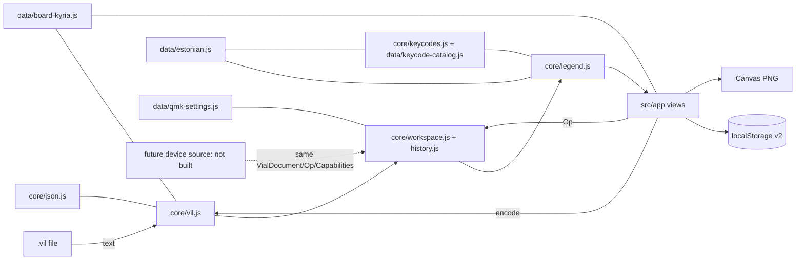

# Kyria repository architecture (HLA)

## 1. Status

- Tier: Feature (one new browser-only subsystem in an existing repository; no server, no datastore beyond browser storage). UI, file-format and publication overlays apply.
- Readiness: **READY** (amended 2026-10-25 after Vial research).
  - Boundaries, file ownership, module APIs and the data model are unchanged from the PROVISIONAL draft (`a5f1437`). Only data and rules were added.
  - The former research questions VERIFY-R1..R8 are resolved in LLA §9.
  - Two non-critical labelled assumptions remain: ASSUMPTION-4 and ASSUMPTION-5. Both are isolated to legend text and one editor's checkbox labels.
  - No BLOCKER.
- Scope: Keymap Studio (`keymap-studio/`) and its publication in this repository. Firmware, host helper, tools and backups are unchanged context.
- Subsystem LLA: [`docs/architecture/studio.md`](docs/architecture/studio.md) (READY).

## 2. Context

Canonical brief: `/home/kris/projects/kyria/docs/product/brief.md` on `main` at `d585697`. It covers GOAL-0, GOAL-1, GOAL-2, CAP-1..CAP-5, CONSTRAINT-1..CONSTRAINT-6, Q-1, Q-2 and the "Verified compatibility inputs" section. This branch's copy of the brief predates `d585697`; the canonical file wins.

**Priority (GOAL-0).** The core purpose outranks breadth:
1. Character-first assignment with real Estonian outputs.
2. A readable exported reference image to keep on screen while learning the Kyria.

Vial-style feature editors (CAP-3) are still required, but they follow these two workflows. A full Vial replacement is a future direction only.

Repository and evidence facts:

- FACT — the original is `/home/kris/Documents/kyria-keymap-studio.html` (sha256 `0c787a90…338c`, unchanged). It is one 74-line file with inline CSS/JS.
  - Line 9: the default layout and the 50-key geometry `[row, col, x, y, angle]`.
  - Line 36: imports with `JSON.parse`. Line 34: exports with `JSON.stringify(state.data,null,2)`.
  - Line 27: persists to `localStorage['kyria-studio-v1']`.
  - Line 35: accepts only a 10 × 7 matrix.
  - Line 12: a partial hand-written Estonian table.
  - Lines 69/71: leave tap dance and macro editing to Vial.
  - Line 37: renders the PNG through SVG, then ``, then canvas, using 5.5–7 unit text on 44-unit keys (line 25).
  - Lines 12, 51 and 64: emit `KC_NONUS_BACKSLASH`, which Vial does not know (brief, verified inputs). Vial silently loads unknown names as `KC_NO`.
- FACT — the original's embedded default (line 9 `layout`) is deep-equal to `/home/kris/Documents/kriskyria.vil`. Its `layout_options` is `0`, while the live backup reports `0000000f` (`backups/live-settings.json`). The studio keeps `0` and never rebases it (brief, verified inputs).
- FACT — four Vial-saved files re-serialize **byte-identically** with Python `json.dumps(json.loads(b))`: `/home/kris/Documents/kriskyria.vil`, `/home/kris/Documents/kyriav4current.vil`, `backups/kyriav4current.vil` and `/home/kris/Downloads/colemakdhkris.vil`. Their `uid` is `10669769700359951850`, which is above 2^53.
- FACT — JavaScript `JSON.parse` yields `10669769700359952000` for that uid (Node v22.23.1). `/home/kris/Downloads/kyria-colemak-dh-estonian.vil` and `kyria-colemak-dh-clean.vil` already carry the rounded uid.
- FACT — the owner's Vial files use Vial names such as `KC_BSPACE`, `KC_SCOLON`, `KC__VOLUP`, `RM_TOGG` and `LSFT_T(KC_A)`. The original picker offers `RGB_TOG`-style names (line 67).
- FACT — `firmware/keyboards/splitkb/halcyon/kyria/keymaps/keypress_hlc/layout_tables.h` holds the Estonian outputs. It is generated from libxkbcommon by `tools/generate_layouts.py`.
- FACT — every layer of the owner's files has 60 non-`-1` matrix cells. Fifty have original geometry. Ten have none: rows 4 and 9, columns 0–4 (module buttons; layer 0 has `KC_MUTE` at 4,0 and 9,0).
- FACT — `backups/live-vial-definition.json` is identical to `firmware/.../keypress_hlc/vial.json`. It defines four layout-option labels and four encoders.
- FACT — Node v22.23.1 and Playwright browser builds exist on this host. There is no npm project. `.gitignore` ignores `/docs/`.

Decisions confirmed by the primary (answered or defaults sufficient; no further questions):
- ASSUMPTION-1: UI copy is English; the keyboard layout is Estonian only.
- ASSUMPTION-2: the default keymap is the original app's embedded layout, stored as the exact `kriskyria.vil` text, until an explicit import.
- ASSUMPTION-3: the studio is Kyria rev4 specific.
- The rounded uid gets an explicit, undoable restore action.
- The original app's browser storage is not migrated.

Remaining labelled assumptions:
- ASSUMPTION-4: "text" macro actions type through QMK's US-ASCII `send_string`. This affects only macro legend text, which is flagged `approximate` when unmappable.
- ASSUMPTION-5: the key-override `*_mods` bytes use the QMK 8-bit mod-bit order (LCtl, LSft, LAlt, LGui, RCtl, RSft, RAlt, RGui = bit 0..7). The UI always shows the raw byte next to the decoded checkboxes.

Non-goals (CONSTRAINT-1, CONSTRAINT-5): WebHID, device detection or reads, flashing, live sync, a locale switcher, non-Kyria boards, KLE parsing, a build pipeline, servers, network access, and a separate repository or deployment (CONSTRAINT-6).

## 3. Recommendation

A static browser app in `keymap-studio/`, opened directly as `keymap-studio/index.html` from `file://`. It loads ordered **classic scripts** under the namespace `globalThis.KyriaStudio`, with no build, server or dependency (ADR-S1). It has three layers:

1. **Pure core** (`src/core`, `src/data`) has no DOM, storage, time or network access. It contains:
   - the lossless JSON reader/writer and the `.vil` codec;
   - the document, operations and undo history;
   - the keycode catalog, ported from Vial `keycodes.py`, and the character-first lookup;
   - the Estonian output table and the legend model;
   - the layout-options and QMK-settings tables.

   It runs unchanged in the browser and in `node --test`.
2. **App** (`src/app`, `index.html`, `styles/`) owns the DOM, file input/output, localStorage, board view, character picker, action composer, feature editors and Canvas PNG export.
3. **Source seam**: today the only document source is a `.vil` file. Capabilities come from the file and are never synthesized. A future device source (connection or full replacement) produces the same `VialDocument` + `Capabilities` and consumes the same `Op` stream. Nothing for it is implemented now (CONSTRAINT-5).

Delivery order follows GOAL-0. First comes the character-first assignment, legends, learning PNG and lossless import/export. The feature editors follow. Publication happens only after the gates pass (CONSTRAINT-6).

## 4. Options considered

| Decision | Chosen | Runner-up | Why |
| --- | --- | --- | --- |
| Packaging | Directory of classic scripts | One self-contained HTML built by concatenation | Works from `file://` with no step, and files can be owned by parallel lanes. ES modules fail from `file://` in Chromium. |
| JSON | Own lossless parser to node tree + Python-style writer | `JSON.parse` reviver | Exact uid, key order and unknown data, and byte-identical round-trip. |
| Assignment | Character-first picker + action composer | Keycode-first picker (original) | GOAL-0. The Vial keycode list hides the Estonian outputs. |
| PNG | Canvas 2D drawn from the legend model | Original SVG, then image, then canvas | Direct control of text size for on-screen reading. |
| Estonian data | Port of repo `layout_tables.h`, cross-checked by test | Original hand table | xkb-generated and authoritative. |

## 5. Capabilities and flows

- FLOW-0 Character-first assign (GOAL-0, CAP-1): the user selects a key, then picks an Estonian character such as `õ`, `@` or `€`. `keycodes.forCharacter` supplies the simplest code (for example `RALT(KC_2)`), which becomes an `Op`, with an immediate legend update. Dead accents and composed letters are labelled honestly.
- FLOW-1 Import: file input, then `vil.decode` with issues. Errors leave the workspace unchanged. Warnings are shown and the file is loaded.
- FLOW-2 Edit: UI action, then `Op`, then `history.commit`, then autosave and re-render. Undo and redo work on snapshots.
- FLOW-3 Export `.vil`: `vil.validate` runs first. Errors block export, including any missing Vial-required `layout`, `encoder_layout` or `layout_options`. Then `vil.encode` and download. An unedited document exports byte-identically.
- FLOW-4 Learning PNG (GOAL-0, CAP-4): `legend.*` for the chosen layers, Canvas, `toBlob`, then download. The image is sized for on-screen viewing at 100%.
- FLOW-5 Recovery: corrupt or old storage gives a message and the built-in default. `kyria-studio-v1` is never written.
- FLOW-6 Publish (CONSTRAINT-6): after the echo and artist gates, commit `keymap-studio/` and a root README entry with usage and limits, then fast-forward push to `origin`. This flow is the primary's.

## 6. Architecture

Containers in this repo: firmware (`firmware/`), host helper (`host/`), Python tools (`tools/`), backups (`backups/`) and **keymap-studio** (new, browser). The studio's coupling to the rest of the repo is test-time reading of `backups/*.vil` and `layout_tables.h` as oracles, plus one root README entry. There is no runtime coupling.

Ownership and the four parallel lanes are in LLA §3.

## 7. Frontend/Backend contract

N/A for a network API, because there is no backend. The in-browser contracts are in the LLA:
- APIs: `API-JSON`, `API-VIL`, `API-WS`, `API-KC`, `API-LEG`.
- Schemas: `SCHEMA-DOC`, `SCHEMA-WS`.
- UI: `UI-1..UI-9`.

`keymap-studio/DESIGN.md` (artist) governs visuals.

## 8. Tech choices

- ES2020 classic scripts for current Chromium and Firefox. No third-party code.
- Tests: built-in `node:test`. `make studio-test` runs `node --test 'keymap-studio/tests/*.test.js'`. FACT: the bare directory form fails on Node v22.23.1. Static check: `node --check <file>`.
- Fonts: the system font stack only.
- Vial compatibility baseline: vial-gui `main` at `aef8222a2d0429a183b2ed692d5f9efcfd383f08` (sources in §19).

## 9. NFRs (detail in LLA §6)

- QA-0: character-first assignment for every Estonian character on the layout.
- QA-1: lossless round-trip.
- QA-2: exact uid.
- QA-3: offline `file://` in Chromium and Firefox with zero network requests.
- QA-4: WCAG 2.2 AA.
- QA-5: readable on-screen PNG text.
- QA-6: persistence and recovery.
- QA-7: clear errors and no silent failure.
- QA-8: never emit a name Vial would turn into `KC_NO`.

## 10. Data governance

The only data is the owner's keymap and browser-local studio metadata. It is never sent anywhere, and the `.vil` never receives studio metadata (ADR-S8). On publication (CONSTRAINT-6), the built-in default layout becomes public. This matches the `.vil` files already published in `backups/`.

## 11. Threat model (detail in LLA §7)

- Asset: the keymap and its exact uid.
- Untrusted input: imported `.vil` and stored JSON.
- Threats:
  - script injection;
  - parser exhaustion;
  - prototype pollution;
  - storage corruption;
  - silent data loss, including Vial's silent `KC_NO` conversion.
- Controls:
  - text-only sinks;
  - bounded parser;
  - entry-array objects;
  - validated restore;
  - catalog-checked user input;
  - no network.

## 12. Testing

- Node tests cover the core contracts, with owner files as oracles: byte-identical round-trip, uid, Estonian cross-check against `layout_tables.h`, catalog names, layout-options packing and settings ranges.
- Artist runs functional and visual checks over `file://` in Chromium and Firefox.
- Echo verifies the core lanes.
- The test matrix is in LLA §8.

## 13. Cost

No runtime cost and no dependencies. Development cost is the four lanes in LLA §3.

## 14. Delivery

- MILESTONE-1 (GOAL-0 slice): L1 codec, L2 keys/legends and L4 tests in parallel. L3 builds the shell, board, character picker and learning PNG against the APIs.
- MILESTONE-2: L3 feature editors (macros, tap dance, combos, key overrides, alt repeat, encoders, settings, layout options, module buttons).
- MILESTONE-3: echo for the core lanes, artist checks, landing on `main`, then publication to `origin` (CONSTRAINT-6).

Rollback: revert the studio commits. The original HTML is untouched.

## 15. Risks

- RISK-1 (low/high, was med/high): name or schema drift from Vial. Mitigation:
  - pinned vial-gui commit;
  - catalog ported from `keycodes.py`;
  - user-typed codes must be catalog-known (QA-8);
  - imported unknown codes are kept verbatim with a warning.

  Owner: L2. Trigger: a new Vial release.
- RISK-2 (low/high): uid or unknown-field loss. Mitigation: own parser and byte-identity tests. Owner: L4.
- RISK-3 (med/med): legends differ from what is typed (dead keys, text macros). Mitigation: xkb-derived table, the xkb dead-key list in LLA §4, and the `approximate` flag (ASSUMPTION-4). Owner: L2.
- RISK-4 (low/med): storage quota or multi-tab overwrite. Mitigation: explicit error, a warning on the `storage` event, and `.vil` export as the real save.
- RISK-5 (low/med): Vial truncates feature entries beyond the device's counts on load (FACT: `restore_key_override` keeps `x < key_override_count`). Mitigation: ops never change counts, and UI-9 states the limit.

## 16. ADRs

Recorded in LLA §10 (ADR-S1..ADR-S10) and adopted here:
- ADR-S1: classic scripts, no build.
- ADR-S2: lossless JSON.
- ADR-S3: verbatim keycodes.
- ADR-S4: core/app/source separation.
- ADR-S5: Canvas PNG.
- ADR-S6: Estonian data from `layout_tables.h`.
- ADR-S7: transparent keys show layer 0.
- ADR-S8: browser-only metadata.
- ADR-S9: `node:test`.
- ADR-S10: character-first primary picker.

## 17. Diagrams

See §6.

## 18. Verification

Traceability:
- GOAL-0 → FLOW-0, FLOW-4, API-KC `forCharacter`, API-LEG, UI-4, UI-6, QA-0, QA-5.
- GOAL-1 → CAP-1, CAP-4, CAP-5 → UI-1..UI-9.
- GOAL-2 → CAP-2, CAP-3 → API-JSON, API-VIL, API-WS.
- CONSTRAINT-1 and CONSTRAINT-5 → ADR-S4.
- CONSTRAINT-2 → API-KC and `data/estonian.js` only.
- CONSTRAINT-3 → LLA §3 no-touch list, VERIFY-8.
- CONSTRAINT-4 → `Capabilities` from the file, UI-9.
- CONSTRAINT-6 → FLOW-6, MILESTONE-3, VERIFY-9.

Each CAP maps to `VERIFY-*` in LLA §8.

## 19. Sources

- Repository and local files are cited inline; checked 2026-10-25.
- Vial GUI `main` at `aef8222a2d0429a183b2ed692d5f9efcfd383f08`, accessed 2026-10-25, via researcher and bounded architect reads. These govern Vial behaviour only at that commit.
  - https://github.com/vial-kb/vial-gui/blob/main/src/main/python/protocol/keyboard_comm.py
  - https://github.com/vial-kb/vial-gui/blob/main/src/main/python/keycodes/keycodes.py
  - https://raw.githubusercontent.com/vial-kb/vial-gui/aef8222a2d0429a183b2ed692d5f9efcfd383f08/src/main/python/protocol/key_override.py
  - https://raw.githubusercontent.com/vial-kb/vial-gui/aef8222a2d0429a183b2ed692d5f9efcfd383f08/src/main/python/editor/layout_editor.py
  - https://raw.githubusercontent.com/vial-kb/vial-gui/aef8222a2d0429a183b2ed692d5f9efcfd383f08/src/main/resources/base/qmk_settings.json
  - `protocol/{tap_dance,combo,alt_repeat_key}.py` (researcher)
