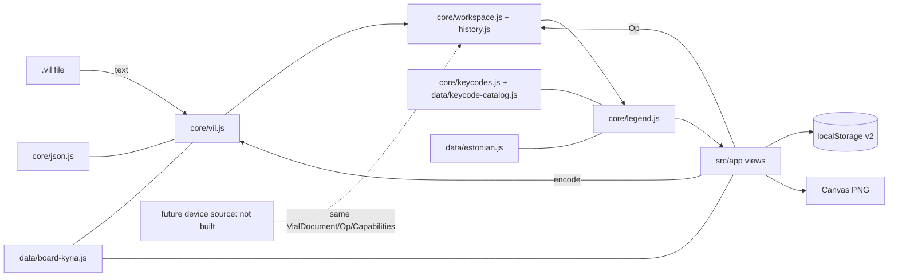

# Kyria repository architecture (HLA)

## 1. Status

- Tier: Feature (one new browser-only subsystem in an existing repository; no server, no datastore beyond browser storage). UI and file-format overlays apply.
- Readiness: **PROVISIONAL**. Boundaries, file ownership, module APIs and data model are READY for Stage 2. Vial schema details that the researcher is confirming are PROVISIONAL and isolated behind `VERIFY-R*` items in the LLA (`docs/architecture/studio.md` §9). No BLOCKER.
- Scope: Keymap Studio (`keymap-studio/`). Firmware, host helper, tools and backups are unchanged context.
- Subsystem LLA: [`docs/architecture/studio.md`](docs/architecture/studio.md) (PROVISIONAL, decomposable now).

## 2. Context

Brief: `docs/product/brief.md` (GOAL-1, GOAL-2, CAP-1..CAP-5, CONSTRAINT-1..CONSTRAINT-5, Q-1, Q-2).

Repository and evidence facts:

- FACT — `docs/product/brief.md:6`: improve the editor in `/home/kris/projects/kyria/keymap-studio` without modifying `/home/kris/Documents/kyria-keymap-studio.html` (sha256 `0c787a90…338c` at Stage 1).
- FACT — `AGENTS.md:37`: the editor exports Vial maps and PNG references and never connects to hardware.
- FACT — `/home/kris/Documents/kyria-keymap-studio.html` is one 74-line file with inline CSS/JS. Line 9 embeds the default layout and the 50-key geometry `[row, col, x, y, angle]`. Line 36 imports with `JSON.parse`, line 34 exports with `JSON.stringify(state.data,null,2)`, line 27 persists to `localStorage['kyria-studio-v1']`, line 35 accepts only a 10 × 7 matrix, line 12 holds a partial hand-written Estonian table, lines 69/71 leave tap dance and macro editing to Vial, line 37 renders the PNG through SVG, then ``, then canvas, using 5.5–7 unit text on 44-unit keys (line 25).
- FACT — the Vial-saved files `/home/kris/Documents/kriskyria.vil`, `/home/kris/Documents/kyriav4current.vil`, `backups/kyriav4current.vil` and `/home/kris/Downloads/colemakdhkris.vil` re-serialize **byte-identically** with Python `json.dumps(json.loads(b))` (checked at Stage 1). Top-level keys: `version, uid, layout, encoder_layout, layout_options, macro, vial_protocol, via_protocol, tap_dance, combo, key_override, alt_repeat_key, settings`. `uid` = `10669769700359951850`, which is above 2^53.
- FACT — JavaScript `JSON.parse` turns that uid into `10669769700359952000` (checked with Node v22.23.1). `/home/kris/Downloads/kyria-colemak-dh-estonian.vil` and `kyria-colemak-dh-clean.vil` already contain this rounded uid. This loss is real and has already happened.
- FACT — the owner's Vial files use Vial-written names such as `KC_BSPACE`, `KC_SCOLON`, `KC__VOLUP`, `RM_TOGG`, `RM_NEXT`, `LSFT_T(KC_A)`, `RALT(KC_S)`, `DF(n)`, `M0`. The original picker offers `RGB_TOG`-style names (line 67), which do not match.
- FACT — `firmware/keyboards/splitkb/halcyon/kyria/keymaps/keypress_hlc/layout_tables.h` was generated by `tools/generate_layouts.py` from libxkbcommon. It holds Estonian `ee` and `ee(nodeadkeys)` output per HID usage for plain, Shift, AltGr and Shift+AltGr. Letters are uppercased for display.
- FACT — `backups/live-vial-definition.json` is identical to `firmware/.../keypress_hlc/vial.json`. It has a 10 × 7 matrix, `lighting: vialrgb`, layout-option labels and 4 encoders. Matrix rows 4 and 9 are not in the original geometry.
- FACT — Node v22.23.1 and Playwright browser builds (`~/.cache/ms-playwright`: chromium, firefox, webkit) are present on this host. No npm project exists in the repo.
- FACT — `.gitignore` ignores `/docs/`. Architecture docs are force-added by exact path.

Assumptions (labelled; defaults used until the owner answers):

- ASSUMPTION-1: UI copy stays English, as in the original. "Estonian only" refers to the keyboard layout (CONSTRAINT-2). Owner question OQ-1.
- ASSUMPTION-2: the built-in starting layout is the exact text of `/home/kris/Documents/kriskyria.vil`, the file the original embeds. Owner question OQ-2.
- ASSUMPTION-3: the studio stays Kyria rev4 specific (10 × 7 matrix, existing geometry), as in original line 35.

Non-goals (CONSTRAINT-1, CONSTRAINT-5): WebHID, device detection, flashing, live sync, a locale switcher, non-Kyria boards, KLE definition parsing, a build pipeline, servers, and network access.

## 3. Recommendation

A static browser app in `keymap-studio/`. It is opened directly as `keymap-studio/index.html` from `file://` and loads ordered **classic scripts** under one global namespace, `globalThis.KyriaStudio`. There is no build, server or dependency (ADR-S1). It has three layers:

1. **Pure core** (`src/core`, `src/data`) has no DOM, storage, time or network access. It contains the lossless JSON reader/writer, the `.vil` codec, the document and operations, undo history, keycode grammar, the Estonian output table and the legend model. It runs unchanged in the browser and in `node --test`.
2. **App** (`src/app`, `index.html`, `styles/`) owns the DOM, file input/output, localStorage, the board view, picker, feature editors and Canvas PNG export.
3. **Source seam**: today the only document source is a `.vil` file. Capabilities are derived from the file, never assumed. A future device transport would be a new source producing the same `VialDocument` + `Capabilities` and consuming the same `Op` stream. Nothing for it is implemented now (CONSTRAINT-5).

## 4. Options considered

| Decision | Chosen | Runner-up | Why |
| --- | --- | --- | --- |
| Packaging | Directory of classic scripts | One self-contained HTML built by concatenation | Works from `file://` with no step, and files can be owned by parallel lanes. ES modules fail from `file://` in Chromium (opaque origin). A single file would need a build step or one shared file for every lane. |
| JSON | Own lossless parser to node tree + Python-`json.dumps`-style writer | `JSON.parse` reviver with source text | The reviver still needs a custom writer, and browser support varies. A node tree also keeps key order and unknown fields exactly. |
| PNG | Canvas 2D drawn from the legend model | Original SVG, then image, then canvas | Gives direct control of text size and no image-decoding or taint path. |
| Estonian data | Port of repo `layout_tables.h`, cross-checked by test | Original hand table | The repo table is generated from xkb and is authoritative (FACT above). |

## 5. Capabilities and flows

- FLOW-1 Import: file input, then `vil.decode` with issues. Errors are reported and the workspace is unchanged. Warnings are shown and the file is loaded.
- FLOW-2 Edit: UI action, then `Op`, then `history.commit`, then autosave and re-render. Undo and redo work on snapshots.
- FLOW-3 Export `.vil`: `vil.validate` (errors block), then `vil.encode`, then download. An unedited document exports byte-identically.
- FLOW-4 Export PNG: `legend.*` for every visible layer, then Canvas, then `toBlob`, then download.
- FLOW-5 Recovery: corrupt or old storage leads to a clear message and the built-in default layout. The original app's `kyria-studio-v1` key is never written.
- Failure and abuse: oversized (>2 MB, original line 36) or deeply nested input, wrong matrix, malformed sections and hostile strings. Handled in LLA §7.

## 6. Architecture

Containers in this repo: firmware (`firmware/`), host helper (`host/`), Python tools (`tools/`), backups (`backups/`) and **keymap-studio** (new, browser). The studio's only coupling to the rest of the repo is test-time reading of `backups/*.vil` and `layout_tables.h` as oracles. There is no runtime coupling.

Ownership and parallel lanes are defined in LLA §3: core-codec, core-keys, app (artist) and tests.

## 7. Frontend/Backend contract

N/A for a network API, because there is no backend. The in-browser contracts (`API-JSON`, `API-VIL`, `API-WS`, `API-KC`, `API-LEG`, `SCHEMA-DOC`, `SCHEMA-WS`, `UI-1..UI-9`) are in the LLA. `keymap-studio/DESIGN.md` (artist) governs visuals and implements UI-* states.

## 8. Tech choices

- ES2020 classic scripts for current Chromium and Firefox. No third-party code. Uses `structuredClone`, `Blob`, `URL.createObjectURL`, `HTMLCanvasElement.toBlob`, `File.text()`, `BigInt` (uid range check only) and `String.prototype.normalize`.
- Tests: built-in `node:test` (Node ≥ 20; v22.23.1 present). Command `make studio-test` runs `node --test 'keymap-studio/tests/*.test.js'`. FACT: the bare directory form fails on Node v22.23.1 (checked at Stage 1). Static check: `node --check <file>`.
- Fonts: the system font stack only. Bundled `@font-face` from `file://` is unreliable under opaque origins.

## 9. NFRs (summary; detail in LLA §6)

QA-1 lossless round-trip, QA-2 exact uid, QA-3 offline `file://` in Chromium and Firefox with zero network requests, QA-4 WCAG 2.2 AA keyboard/focus/name, QA-5 readable PNG text ratio, QA-6 persistence and recovery, QA-7 clear errors and no silent failure.

## 10. Data governance

The only data is the owner's keymap and browser-local studio metadata (layer names, colors, label overrides). It is stored in localStorage under a new key and never sent anywhere. The `.vil` never receives studio metadata (ADR-S8). A built-in default layout copied into the repo is the owner's own layout, consistent with `backups/*.vil` already being tracked (OQ-2).

## 11. Threat model (summary; detail in LLA §7)

Asset: the owner's keymap and its exact uid. Untrusted input: imported `.vil` files and stored workspace JSON. Threats: script injection through keycode or macro strings, parser stack exhaustion, prototype pollution, storage corruption and silent data loss. Controls: text-only DOM/canvas sinks, a depth and size bounded parser, entry-array objects, validated restore, and no network or `innerHTML` with file data.

## 12. Testing

Core contracts are covered by node tests using owner files as oracles (byte-identical round-trip, uid, Estonian cross-check against `layout_tables.h`). Artist runs functional and visual checks over `file://` in Chromium and Firefox. Echo verifies the core lanes. Matrix in LLA §8.

## 13. Cost

No runtime cost. No dependencies. Development cost is the four lanes in LLA §3.

## 14. Delivery

MILESTONE-1 core lanes and tests (parallel). MILESTONE-2 artist integration and PNG. MILESTONE-3 echo + artist checks, landing on `main`. Rollback: the original HTML is untouched and still usable.

## 15. Risks

- RISK-1 (med/high): Vial name or schema mismatches (keycode names, settings ids, macro forms). Mitigation: keep unedited strings verbatim, emit only names Vial itself wrote or the researcher confirmed, keep `VERIFY-R*` provisional. Owner: architect + researcher. Trigger: researcher report.
- RISK-2 (low/high): uid or unknown-field loss. Mitigation: own parser, byte-identity tests. Owner: tests lane.
- RISK-3 (med/med): legends differ from what is actually typed (dead keys, text macros). Mitigation: xkb-derived table, the xkb dead-key list fixed in LLA §4, an explicit "approximate" flag. Owner: core-keys.
- RISK-4 (low/med): browser storage quota or multi-tab overwrite. Mitigation: explicit error, `storage` event warning, `.vil` export as the real save.

## 16. ADRs

Recorded in the LLA (ADR-S1..ADR-S9). This HLA adopts them: ADR-S1 classic scripts/no build, ADR-S2 lossless JSON, ADR-S3 document mirrors `.vil` with verbatim keycodes, ADR-S4 core/app/source separation with `Op` + `Capabilities`, ADR-S5 Canvas PNG, ADR-S6 Estonian from `layout_tables.h`, ADR-S7 transparent keys show layer 0, ADR-S8 metadata in browser only under a new key, ADR-S9 `node:test`, no npm.

## 17. Diagrams

See §6.

## 18. Verification

Traceability: GOAL-1 → CAP-1, CAP-4, CAP-5 → UI-1..UI-9, API-KC, API-LEG. GOAL-2 → CAP-2, CAP-3 → API-JSON, API-VIL, API-WS. CONSTRAINT-1, CONSTRAINT-5 → ADR-S4 (no transport code). CONSTRAINT-2 → API-KC catalog and `data/estonian.js` only. CONSTRAINT-3 → LLA §3 no-touch list, VERIFY-8. CONSTRAINT-4 → `Capabilities` from file, UI-9, VERIFY-R7. Each CAP maps to `VERIFY-*` in LLA §8. The Stage 1 self-check commands are listed in the handoff.

## 19. Sources

Repository files cited above. Local file evidence was checked on 2026-10-25. External Vial schema facts are delegated to the researcher (LLA §9). No external URLs are relied on in this HLA.
